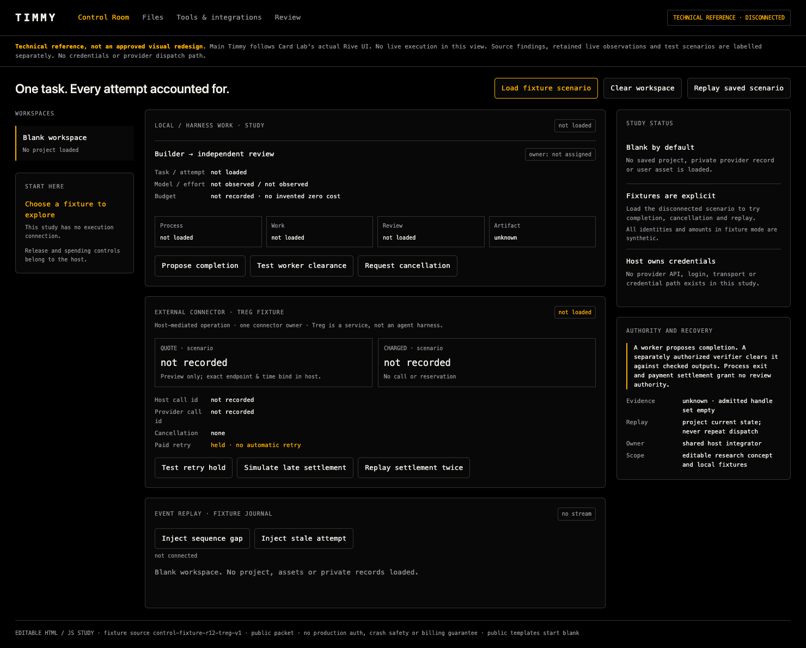
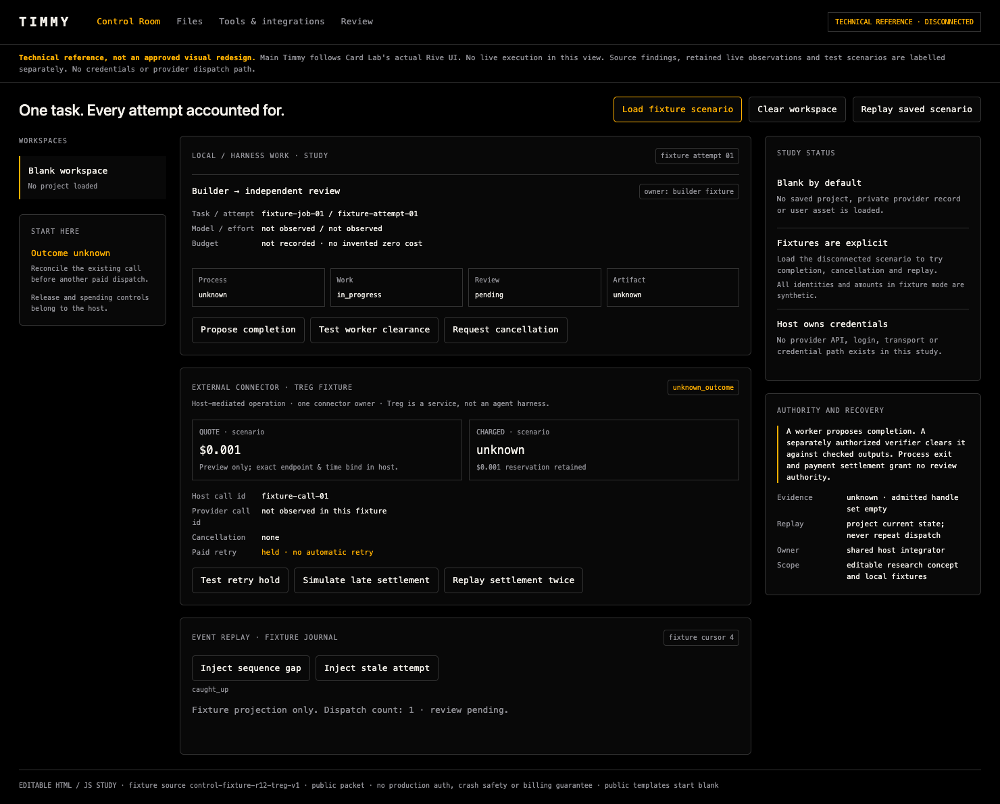

# Control Room research handoff — 2026-10-27

**Owner:** timmy-new-3 for this research packet; Claude for shared Timmy host implementation. **Status:** disconnected concept and fixture checks, not integrated or release-qualified UI.

**Main UI baseline:** reuse and adapt Card Lab's actual native/editable Rive components and interaction design. This standalone architecture explainer is technical reference, not an approved visual redesign. Coordinate host adoption with the integrator and app owners.

This packet is based on shared integration revision **37fa0cba217e89472d6c1475e6cfffbcc8438168** (`r13/integration`). It adds only this directory. The empty-panel and host-theme fixes already present at that revision are outside this handoff. Reconcile the current integration tip before implementation.

Start with [the implementation slice](IMPLEMENTATION-SLICE.md), [source findings](SOURCE-FINDINGS.md), and [CAD candidates](CAD-CANDIDATES.md). The two native/editable files [room.html](room.html) and [room-ui.mjs](room-ui.mjs) use the original fixture reducer [room-model.mjs](room-model.mjs).

## Actual local renders

The public template starts blank. The second image is an explicitly loaded synthetic scenario. Neither image is an integrated Timmy runtime screenshot or an actual provider account/call.





No private project, creative asset, financial record, credential, account identifier, provider response, raw session or private receipt is included. The fixture identities and amounts are synthetic. Private raw observations and failures remain outside the repository.

## Try it locally

From the repository root, serve only this packet:

```sh
python3 -m http.server 8770 --bind 127.0.0.1 --directory docs/handoffs/control-room-2026-10-27
```

Open `http://127.0.0.1:8770`. The initial view is empty; **Load fixture scenario** enables the local controls. **Clear workspace** or reload returns to blank. There is no provider transport or credential path.

Run the deterministic scenarios from this directory:

```sh
node room-scenarios.mjs
node capture-study.mjs
```

The capture script uses the repository's existing Playwright development dependency and its installed Chromium. `TIMMY_STUDY_CHROME` may explicitly select an installed Chrome executable. `TIMMY_STUDY_PLAYWRIGHT_ROOT` may select another existing dependency root; no package is downloaded by this script. Optional first argument selects the output directory. The capture process closes its owned browser and loopback server.

[CHECKS.md](CHECKS.md) records commands, source hashes, expected/observed results and limits. The 11 reducer/file-replay scenarios and 16 browser controls are fixture checks. They do not establish production authorization, concurrent writers, durable crash safety, provider cancellation or billing guarantees.

## Scope and holds

The host integrator owns jobs, registry, frame, Files, canonical receipts and the single Treg connector. App owners retain their apps. Stream Studio remains unassigned/not built at the cited base. This research packet does not assign a new app owner or start its implementation.

The current operator authorized this side-branch handoff push. Merge, release, tags, deployment, purchases and new paid runs remain held. Agent Archive stays disabled. This packet does not append to a shared receipt chain.
